# 🌉 ShareBridge

[](https://github.com/mdrayhan03/ShareBridge/actions)


ShareBridge is a high-performance, offline-first peer-to-peer (P2P) communication and massive file-sharing application. Built for desktop and mobile, it allows devices on the same local network (Wi-Fi or LAN) to automatically discover each other, form a real-time chat room, and stream gigabytes of files simultaneously—**without requiring an internet connection, third-party accounts, or cloud intermediaries**.

**⬇️ Download Installers:** [mdrayhan03.github.io/ShareBridge](https://mdrayhan03.github.io/ShareBridge/) · Windows · macOS · Linux · Android (APK)

---

## 🏛️ System Architecture

ShareBridge operates on a hybrid peer-to-peer model. While chat and room membership state are coordinated via a local WebSocket host, **all file transfers happen directly between peers via asynchronous HTTP binary streams**.

```mermaid
graph TD
    subgraph Discovery ["1. Zero-Configuration Local Discovery"]
        HostBeacon["Host UDP Broadcaster (Port 37020)"]
        PeerListener["Client UDP Listener"]
        PeerListener -.->|"Auto-detects host IP"| HostBeacon
    end

    subgraph MessagingState ["2. Real-Time Chat & State Coordination"]
        WSHost["Host WebSocket Server (Port 8765)"]
        WSClientA["Peer A WebSocket Client"]
        WSClientB["Peer B WebSocket Client"]
        WSClientA <-->|"JSON Event Packets (Rooms, Users, Messages)"| WSHost
        WSClientB <-->|"JSON Event Packets (Rooms, Users, Messages)"| WSHost
    end

    subgraph BinaryStreaming ["3. High-Throughput P2P File Streaming"]
        HTTPServerA["Peer A Local HTTP Server (aiohttp)"]
        TokenRegistryA["Ephemeral Token Registry (/download/<uuid>)"]
        HTTPClientB["Peer B Stream Downloader"]
        
        HTTPServerA --- TokenRegistryA
        HTTPClientB -->|"GET /download/<uuid> (Chunked 64KB Streams)"| HTTPServerA
    end
```



---

## ✨ Engineering Highlights

### 1. High-Throughput Chunked Binary Streaming (20GB+ Files)
Traditional file sharing tools load large files into RAM, causing system freezes or mobile OS Out-Of-Memory (OOM) crashes.
- ShareBridge uses **`aiohttp` non-blocking asynchronous generators** to stream binary data in fixed 64KB chunks directly from disk to socket.
- Memory usage stays flat (typically **<60MB RAM**) whether transferring a 500KB photo or a **20GB+ video/archive**.

### 2. Zero-Config UDP Network Discovery (Port 37020)
- The hosting device broadcasts lightweight UDP beacons containing room metadata.
- Joining devices listen on UDP port 37020 and automatically negotiate connections without requiring manual IP address entry.
- Includes a loopback beacon and local-server probe, ensuring instances on the same host machine discover each other even if OS firewalls block external LAN broadcasts.

### 3. Ephemeral Token Registry Security (Zero Path Disclosure)
- Files are **never exposed via raw filesystem paths**.
- When a user attaches a file, ShareBridge generates a cryptographically random, ephemeral UUID token and binds it in an in-memory token registry:
  ```
  GET http://<peer-ip>:<port>/download/7b2e8a9f-3c4d-4e5f-9a1b-2c3d4e5f6a7b
  ```
- Receivers download strictly via this token. Nothing outside what the sender explicitly shared is accessible, and physical directory structures are never exposed over the network.

### 4. Dependency-Free Strict Schema Validation
- Real-time JSON packets are parsed and validated through a lightweight, custom schema validator.
- Malformed packets are safely dropped rather than crashing the runtime, ensuring clean Android compilation without heavy native C-extensions.

---

## 🛠️ Technology Stack

| Layer | Technologies |
| :--- | :--- |
| **Runtime & Core** | Python 3.12+, AsyncIO |
| **UI Framework** | Kivy, KivyMD 2.0 (Material Design 3 for Desktop and Mobile) |
| **Real-Time Messaging** | WebSockets (Full-duplex bidirectional TCP event routing) |
| **Binary Streaming** | Aiohttp (Asynchronous HTTP server & client chunked streams) |
| **OS Integrations** | Plyer (Native file pickers across macOS, Windows, Linux, Android) |
| **Testing** | pytest, pytest-asyncio |
| **Packaging & CI/CD** | PyInstaller, Buildozer, GitHub Actions Matrix Runners |

---

## ⬇️ Download & Install

The easiest way to install ShareBridge is via the official **[Download Page](https://mdrayhan03.github.io/ShareBridge/)**, which continuously serves the latest automated release:

| Platform | Package Format | Guide |
| :--- | :--- | :--- |
| **Windows** | Setup Installer (`ShareBridgeSetup.exe`) | [COMPILE_WINDOWS.md](documents/COMPILE_WINDOWS.md) |
| **macOS** | Native Application Bundle (`ShareBridge.app`) | [COMPILE_MAC.md](documents/COMPILE_MAC.md) |
| **Linux** | Portable Executable / AppImage | [COMPILE_LINUX.md](documents/COMPILE_LINUX.md) |
| **Android** | Installable Package (`.apk`) | [COMPILE_ANDROID.md](documents/COMPILE_ANDROID.md) |

---

## 🚀 Running from Source

### Prerequisites
- Python 3.12 or higher.
- A virtual environment.

### Installation

```bash
git clone https://github.com/mdrayhan03/ShareBridge.git
cd ShareBridge

# Create and activate virtual environment
python3 -m venv venv
source venv/bin/activate        # Windows: venv\Scripts\activate

# Install pinned dependencies
pip install -r requirements.txt
```

### Running the Application

```bash
python MainApplication.py
```

### Running the Test Suite

```bash
pip install pytest pytest-asyncio
pytest tests/
```

---

## 📦 Automated Release Pipelines (GitHub Actions)

Every tagged commit (e.g. `git tag v1.2.0 && git push origin v1.2.0`) triggers a multi-runner GitHub Actions CI pipeline:
1. Builds native executables simultaneously across `windows-latest`, `macos-latest`, and `ubuntu-latest`.
2. Triggers Buildozer container runner to build the Android `.apk`.
3. Publishes assets directly to [GitHub Releases](https://github.com/mdrayhan03/ShareBridge/releases).
4. Updates the public [Download Portal](https://mdrayhan03.github.io/ShareBridge/) automatically.

---

## 📄 License
This project is licensed under the MIT License.
